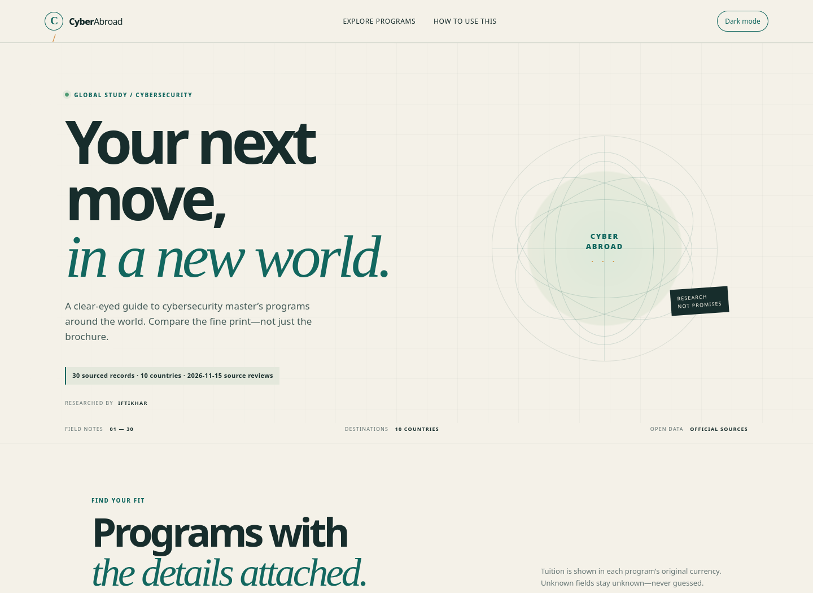
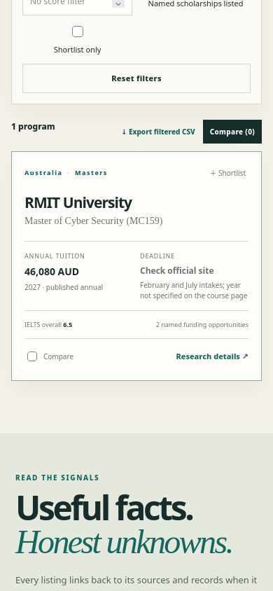
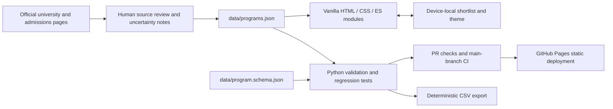

# CyberAbroad

### Find your next cybersecurity classroom — without losing the fine print.

[Explore the website](https://specter-sec.github.io/cyberabroad/) · [Open dataset](data/programs.json) · [Download CSV](data/programs.csv) · [Contribute a correction](CONTRIBUTING.md)


Built by **IFTIKHAR**. CyberAbroad is an independent, mobile-first explorer and open dataset for international cybersecurity students. Its initial research snapshot contains **30 postgraduate programs across 10 countries**, with links to official university/admissions sources and explicit unknowns instead of invented fees or application dates.

> **Verify before applying.** This is a research starting point, not an admissions, scholarship, immigration, or financial adviser. Programs, fees, deadlines, and eligibility can change. Always check official sources. A listed scholarship is not a funding guarantee; a listed date is not a guarantee that applications remain open.

## Explore

- Search university and program names; filter by country, degree, annual tuition budget, listed scholarship opportunities, and verified IELTS overall minimum.
- Compare **up to three** programs, including sources, admission caveats, fees, documents, GRE status, and language requirements.
- Save a device-local shortlist, switch light/dark themes, and export filtered results as a spreadsheet-safe CSV.
- Read calendar-date countdowns for published deadlines, historical/closed labels for past dates, and “check official site” when a date was not established.
- Review source links and individual verification notes before interpreting any value.

The starting collection covers **Germany, Canada, UK, Netherlands, Sweden, Finland, Australia, Malaysia, Turkey, and USA**. All initial entries are master's-level qualifications or clearly identified master's specialisations/joint pathways; this is not a comprehensive ranking or a promise of current availability. The degree filter supports future bachelor's/PhD contributions too.

## Screenshots

Actual screenshots of the working site, using only public program information:





## Compare fairly

**Unknown is not free.** Unverified annual tuition, IELTS minima, or dates are stored as `null`. GRE omission is `unknown`, not “not required.” An absent scholarship list means no qualifying opportunity was established in this snapshot, not that none exists.

**Currencies are not converted.** Budget filtering operates in the selected original currency. Tuition ordering groups by currency, then amount; it is not a cross-currency affordability ranking. Published academic years stay visible. A fee estimate derived from an official total and fixed duration is explicitly marked `annualized_estimate`; living expenses and other compulsory charges may be additional.

**IELTS overall is only one condition.** Band scores, alternatives, exemptions, degree prerequisites, teaching language, nationality restrictions, and intake-specific requirements still apply. Unknown IELTS values are excluded when an IELTS limit is active. Scholarship eligibility and deadlines must be read on their official pages.

**Research date is not an intake year.** `last_verified` records the source review date, not a claim that every field was confirmed. Historical fee years and closed deadlines are retained with notes. Course renamings and joint/mobility pathways are explicitly disclosed. See [data verification rules](CONTRIBUTING.md).

## Run locally

Python **3.10+** and Node.js **22+** are sufficient. No frontend dependency installation or build step is needed.

```sh
git clone https://github.com/specter-sec/cyberabroad.git
cd cyberabroad
python3 -m http.server 8000
```

Open `http://localhost:8000`. Use an HTTP server rather than opening `index.html` directly: browsers restrict module/data loading from `file://` URLs.

## Validate and test

```sh
python3 -m venv .venv
. .venv/bin/activate                 # Windows: .venv\Scripts\activate
python -m pip install -r requirements-dev.txt
python scripts/validate.py
python -m unittest discover -s tests -p 'test_*.py' -v
npm run check
npm test
python scripts/export_csv.py
```

Validation checks the JSON Schema, all ten countries, at least thirty unique records, real calendar dates, no future verification dates, safe HTTPS links, provenance for established facts, explicit null/unknown consistency, and source links for scholarships. Python tests cover data regressions and reproducible CSV exports; dependency-free JavaScript tests cover the explorer's pure logic. Neither schema validation nor CI can prove that an official page is still correct: human source review remains essential.

## Architecture



```text
data/       programs.json, program.schema.json, programs.csv
src/        app UI and pure explorer logic
scripts/    Python validation and reproducible CSV export
tests/      Python and JavaScript regression tests
docs/       real desktop/mobile screenshots and research notes
.github/    validation/Pages workflow and PR checklist
```

## Publish your own copy

Fork the project, enable **Settings → Pages → Source: GitHub Actions**, then push to `main` or run the workflow manually. Every pull request validates data and runs both test suites; only successful non-PR runs deploy. Action references are pinned to immutable commits. The deployed artifact contains only the static app and public dataset, not development files or backups. No token or other secret is needed for the site itself.

## Privacy and limitations

There are no accounts, application forms, trackers, or server-side student profiles. Shortlist IDs and the theme are stored in your browser; clearing site data removes them. Storage can fail or be disabled, in which case persistence is not guaranteed. GitHub Pages infrastructure can retain ordinary hosting logs, and following an official link opens a separate site with its own privacy policy.

This is not an offline PWA and it does not monitor universities for changes. Details are an attributed snapshot, not live availability or a recommendation to apply. Do not place personal documents, contact information, passwords, or application records in this public repository. See [security and data reporting](SECURITY.md).

## Roadmap

1. Expand verified degree levels and country-specific international eligibility notes.
2. Add reviewed intake history without automatically carrying dates forward.
3. Improve accessible comparison and contribution tooling as the dataset grows.

Contributions should improve evidence, not just increase record counts. See [CONTRIBUTING](CONTRIBUTING.md) and the [research snapshot notes](docs/RESEARCH.md).

## License

[MIT](LICENSE) for original code and the original dataset compilation. Official university pages, names, trademarks, and quoted facts remain subject to their respective owners' rights; this project does not license those websites or imply endorsement.
